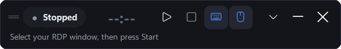
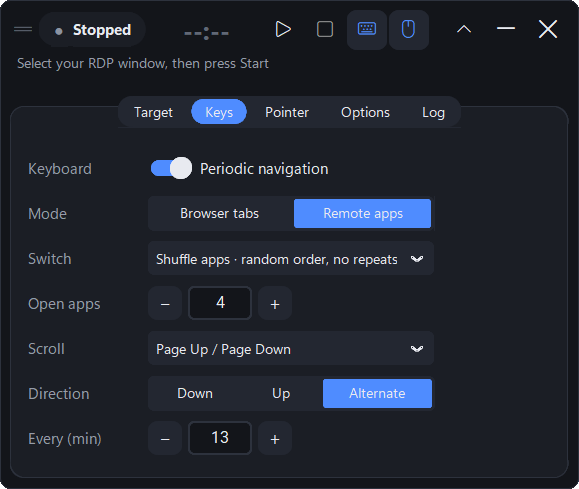
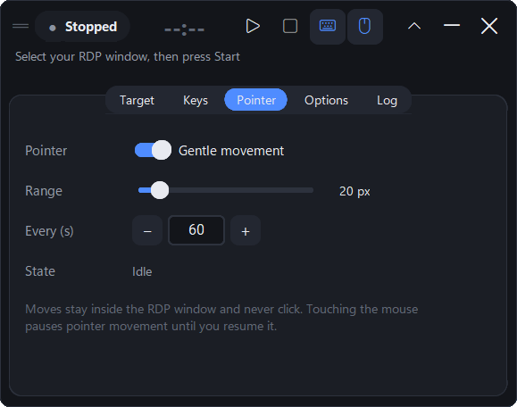
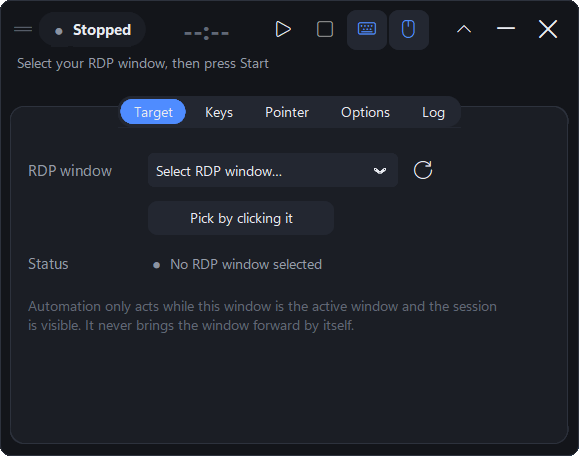

# RDP Nexus

A small floating Windows utility that keeps a **Remote Desktop (RDP) session** gently active.
On a timer (default **13 minutes**) it switches apps or tabs and scrolls *inside the RDP window
you choose*, and it can nudge the mouse pointer a few pixels within that window. Everything stops
the moment the RDP window isn't the active window, and it never touches your local apps.



| Keyboard navigation | Pointer movement | RDP target |
| --- | --- | --- |
|  |  |  |

## Features

- **Compact floating panel**: dark, rounded and draggable, with an optional always-on-top mode and a
  one-line status. Expand it for settings; minimize it to the system tray.
- **Start / Pause / Resume / Stop**, with a countdown to the next cycle and clear states:
  **Stopped**, **Running**, **Paused**, **RDP Unavailable** and **Manual pointer control**.
- **Shuffle apps** (default): visits every app open in the remote session in a random order,
  re-shuffled each round, and **never selects the same app twice in a row**.
- **Remote apps** and **Browser tabs** modes with an allow-list of shortcuts, plus a configurable
  scroll key and direction (down, up or alternate).
- **Gentle pointer movement**: small, smooth glides that stay inside the RDP window's client area,
  with an adjustable range (default 20 px) and no clicks, ever.
- **Your input always wins**: touching the mouse pauses pointer movement until you resume it. Recent
  keyboard or mouse activity, or a held modifier key, skips that cycle.
- Per-user settings, optional launch at sign-in (off by default), a per-user installer that needs no
  admin rights, and a portable exe.

## Install

Download from the [Releases](https://github.com/ADevlooper/RDP-Nexus/releases) page:

| File | Use |
| --- | --- |
| `RDPNexus-<version>-setup.exe` | Installer: per-user, no admin rights. Adds a Start Menu shortcut (desktop shortcut and launch-at-sign-in are optional) and appears in **Settings → Apps** for uninstalling. |
| `RDPNexus-<version>-portable.exe` | Single file, nothing installed. |
| `SHA256SUMS.txt` | Checksums. Verify with `Get-FileHash .\RDPNexus-<version>-setup.exe` |

Requires Windows 10 or 11 (x64). Python is **not** required.

> Windows SmartScreen may warn about an unsigned new app. Choose *More info → Run anyway* only if
> you downloaded it from this repository and the checksum matches.

## Quick start

1. Open your Remote Desktop connection (`mstsc`, or the Microsoft Remote Desktop / Windows App client).
2. In RDP Nexus click **▾** (settings) → **Target**, then pick the RDP window from the list, or click
   **Pick by clicking it** and click inside the RDP window.
3. On the **Keys** tab set **Open apps** to the number of apps open *inside the remote session*
   (the number you would see in its Alt+Tab list).
4. Press **▶ Start**, then **click inside the RDP window** and leave it.
   The countdown starts once the RDP window is the active window.

RDP Nexus never brings the RDP window to the front by itself. If you switch to a local app, it
suspends (shown as **RDP Unavailable**). When you return to the RDP window it restarts the countdown
from the full interval, or waits for you to press Resume (**Options → RDP returns**).

## How it works

### Keyboard navigation (every *N* minutes, default 13)

Each cycle sends **one** switch action, then (after half a second, if the target is still valid)
**one** scroll key.

| Mode | Switch options | Notes |
| --- | --- | --- |
| **Remote apps** | **Shuffle apps** (default), Alt+Page Up (next app), Alt+Page Down (previous app), Off | Alt+Page Up/Down are the Remote Desktop client's own stand-ins for Alt+Tab *inside* the session. RDP Nexus never sends a real Alt+Tab, which would switch your **local** apps in windowed mode. |
| **Browser tabs** | Ctrl+Tab, Ctrl+Shift+Tab, Ctrl+Page Down, Ctrl+Page Up, Off | Acts on the browser that is active in the remote session. |

Scroll: Page Down/Page Up or Arrow Down/Up (or Off), with direction **Down**, **Up** or **Alternate**
(it flips after each successful cycle).

**Shuffle apps** models the remote Alt+Tab list, which Windows keeps in most-recently-used order.
To bring up the app *k* places down that list it holds Alt, presses Page Up *k* times (*k* ≥ 1), then
releases Alt, all as a single atomic input. Each round visits every app once in a fresh random order.
It never starts a round on the app that is already active, so no app ever repeats back-to-back.
RDP Nexus **cannot see inside the remote screen** (RDP only sends pictures), so it can't count your
apps itself. Keep **Open apps** accurate. If you set it higher than the real number, Alt+Tab wraps
around and a switch can land back on the current app.

### Pointer movement

- It arms only after the mouse has rested over the RDP window for 3 seconds. After that it makes one
  small glide (≈0.2–0.7 s) every *N* seconds (default 60), within *range* pixels (default 20) of where
  you left the pointer.
- Glides stay inside the RDP client area, inset from its edges. Each step is checked: the point must
  be inside the area, on a monitor, not covered by another window, and the RDP window must still be
  the active window. Coordinates are physical pixels (per-monitor DPI aware), so display scaling and
  multiple monitors are handled.
- It never clicks, scrolls the wheel, drags or types.
- **Manual control**: any mouse movement, click or wheel event that RDP Nexus didn't generate
  switches pointer movement to **Manual control** at once. It stays paused until you click
  **Resume pointer** (or press Start/Resume). It never resumes just because you stopped moving.

### How input isolation works

| Safeguard | What it does |
| --- | --- |
| Explicit target | Only top-level windows of `mstsc.exe` / `msrdc.exe` with an RDP session window class (`TscShellContainerClass`, `RAIL_WINDOW`) are accepted. The connection dialog and every other window are rejected. |
| Identity re-check | Before every action the stored window handle is re-verified (same process and class), so a recycled handle can never redirect input. |
| Full validation before each action | The window must exist, be responding, visible (not minimized or cloaked on another virtual desktop), have no dialog open and the session's input window present ("connected"), **and be the foreground window**. The workstation must be unlocked with no screen saver running, no modifier key or mouse button held, and no recent user input (10 s). |
| Last-moment check + atomic send | The foreground is checked again immediately before `SendInput`, and the whole chord goes in **one** `SendInput` call. Windows guarantees those events aren't interleaved with other input. |
| Post-delivery check | If focus changed during the send, automation suspends. |
| Fail closed | Any failure (detection hook not responding, a send blocked by Windows, an unexpected error) disables the affected feature rather than retrying blindly. |
| No hidden channels | RDP Nexus never posts window messages to other apps, never steals focus and never runs in the background without its panel or tray icon. |

## Settings, logs and files

| What | Where |
| --- | --- |
| Settings (JSON) | `%APPDATA%\RDP Nexus\settings.json` |
| Logs (rotating, 3 × 512 KB) | `%LOCALAPPDATA%\RDP Nexus\logs\` (Options → Log → *Open log folder*) |
| Installed program | `%LOCALAPPDATA%\Programs\RDP Nexus\` |
| Launch at sign-in | `HKCU\Software\Microsoft\Windows\CurrentVersion\Run` → `RDP Nexus` (removed on uninstall) |

Uninstalling removes the program, shortcuts, the startup entry and the logs. Your `settings.json` is kept.

## Troubleshooting

| Symptom | Fix |
| --- | --- |
| Always **RDP Unavailable – not the active window** | Click inside the RDP window after pressing Start. RDP Nexus itself is a local window, so clicking it takes focus away from RDP. |
| RDP window isn't in the list | Make sure it's connected (not just the "Remote Desktop Connection" dialog) and press ⟳. Only `mstsc.exe`/`msrdc.exe` session windows are supported. |
| App switching does nothing | Check *Local Resources → Keyboard → Apply Windows key combinations* in the RDP client, and that the session has more than one app open. Alt+Page Up/Down are handled by the RDP client. |
| "Blocked by Windows" | The RDP client runs as administrator and RDP Nexus doesn't. Windows blocks input from lower-integrity apps (UIPI), so run both at the same level. |
| Pointer stays on *Arming* | Rest the pointer over the remote desktop (not over the RDP title bar or RDP Nexus) for 3 seconds. |
| Pointer keeps switching to *Manual control* | Something is moving the mouse: you, a touchpad, another tool, or the remote side moving the cursor. That's by design, to fail safe. |
| "Manual-movement detection unavailable" | The low-level mouse hook couldn't be installed (some security tools block hooks). Pointer movement stays disabled; keyboard navigation still works. |
| SmartScreen warning | The executable is not code-signed. Verify the SHA-256 checksum from the release. |

## Limitations (read these)

- **No guarantee against a race at the instant of sending.** Windows has no API that delivers keyboard
  input to one particular window while still behaving like real typing. `SendInput` goes to whatever
  window is in the foreground at the moment Windows processes it. RDP Nexus validates, re-checks,
  sends atomically and verifies afterwards, which narrows the risk window to microseconds but can't
  make it zero. If focus changes within that sliver, one chord could reach the newly focused window.
  The keys are chosen to be harmless locally (no Win key, no Alt+Tab), and automation suspends.
- **Manual-movement detection** relies on a low-level mouse hook plus cursor polling. Input injected
  by other software counts as "manual" too, which is the safe direction. If Windows silently removes
  the hook, the next glide notices the hook stopped seeing events and disables pointer movement.
- **"Connected" is a heuristic.** No public API reports another program's RDP connection state.
  RDP Nexus treats a missing input window, an open dialog, a disabled window or a closed window as
  unavailable. A frozen-but-open session may still look connected.
- **Shuffle apps** can't see the remote screen. It relies on **Open apps** being accurate and on
  nobody else switching apps in between (a mismatch still never re-selects the current app, provided
  the count isn't too high). Each switch presses Page Up *k* times within one Alt hold
  (*k* ≤ Open apps − 1). That's the only way to reach a specific app, and it's sent as one atomic input.
- Shortcut behaviour depends on the RDP client's keyboard settings and on the remote app.
  RemoteApp (`RAIL_WINDOW`) targets work for scrolling and pointer movement, but switching apps there
  moves local focus to another RemoteApp window and so suspends automation.
- Microsoft Remote Desktop / Windows App (`msrdc.exe`) is assumed to use the same session window
  class as `mstsc.exe`; this was not verified with a live `msrdc` session.
- Development and automated tests used stand-in windows with mstsc's real window classes. See
  [docs/TESTING.md](docs/TESTING.md) for the checklist to run against a real Remote Desktop session.

## Responsible use

RDP Nexus doesn't bypass anything: it uses only documented Windows input APIs, acts only inside a
window you select and stops when you take over. It is **not** a tool for defeating organisational
security policies, idle-session limits you are required to respect, activity monitoring or access
controls. Check your organisation's policy before using it on work systems.

## Build from source

Requirements: Windows 10/11, Python 3.10–3.13, and [Inno Setup 6](https://jrsoftware.org/isinfo.php)
for the installer (`winget install JRSoftware.InnoSetup`).

```bat
git clone https://github.com/ADevlooper/RDP-Nexus.git
cd RDP-Nexus
py -3 -m venv .venv
.venv\Scripts\python -m pip install -r requirements-dev.txt
.venv\Scripts\python src\main.py
```

Run the tests:

```bat
.venv\Scripts\python -m pytest
```

Interactive end-to-end tests drive real windows, focus, keyboard and mouse for about a minute
(don't touch anything while they run):

```bat
set RDPNEXUS_INTERACTIVE_TESTS=1
.venv\Scripts\python -m pytest tests\integration -v
```

Build everything (tests → PyInstaller folder + portable exe → Inno Setup installer → checksums):

```bat
scripts\build_windows.bat
```

Artifacts land in `release\`. Pass `--no-installer` to skip Inno Setup, or `--skip-tests`.
To regenerate the icon: `python scripts\make_icon.py`.

## Releasing

1. Bump `APP_VERSION` in `src/app_info.py` and add `docs/releases/v<version>.md`.
2. Commit, then tag and push: `git tag v1.0.1 && git push origin v1.0.1`.
3. The **Build and release** workflow tests, builds and checks that the tag matches `APP_VERSION`.
   It then publishes a GitHub Release with the installer, portable exe and `SHA256SUMS.txt`.

## Project layout

```
src/
  main.py                 entry point (DPI awareness, single instance, logging)
  ui.py                   floating CustomTkinter panel
  scheduler.py            automation engine / state machine (one worker thread)
  keyboard_navigation.py  shortcut allow-list, app shuffler, chord sending
  pointer_controller.py   glide geometry, pointer moves, manual-movement hook
  window_detection.py     RDP window identification and validation
  input_safety.py         safety gate run before every injected input
  settings.py             validated per-user JSON settings
  system_tray.py          tray icon and menu
  autostart.py            optional launch at sign-in
  winapi.py               ctypes bindings for the Win32 APIs used
  app_info.py             name, version, paths
tests/                    unit tests + tests/integration (interactive)
installer/setup.iss       Inno Setup script
scripts/                  build.py, build_windows.bat, make_icon.py
.github/workflows/        CI build and tagged releases
```

## License

[MIT](LICENSE) © 2026 ADevlooper
